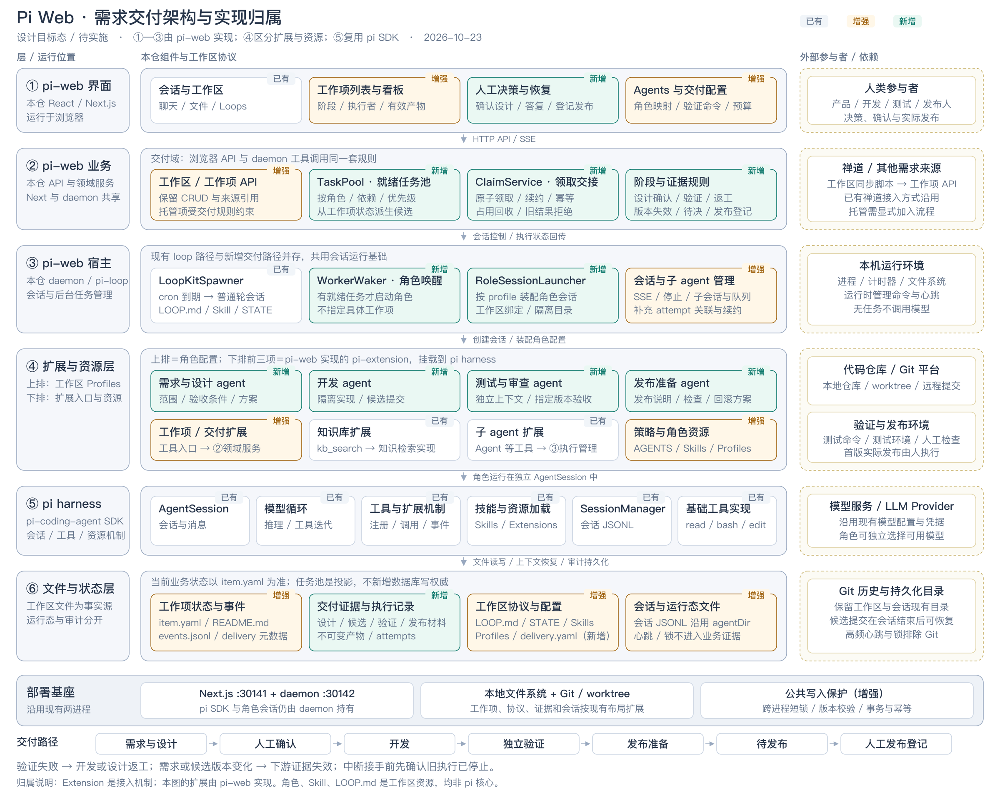

# 工作项自主领取与需求交付设计

日期：2026-10-22

状态：设计草案，待用户审阅；未实施

范围：Pi Web 内单条需求的阶段交接、角色自主领取、验收、返工和恢复

架构图更新：2026-10-23。灰色为已有能力，橙色为增强，绿色为新增；图示为待实施的设计目标态。



[可缩放 SVG 源图](assets/work-item-delivery-architecture.svg)

实现归属：

- **pi-web**：本仓前端、API、交付领域服务、daemon、loop 宿主，以及会话/子 agent 的执行管理；拟新增的 TaskPool、ClaimService、WorkerWaker、RoleSessionLauncher 都在此范围。
- **pi harness**：通过 pi SDK 复用 AgentSession、模型与工具循环、资源/扩展加载、SessionManager 和基础工具；本设计不要求改写这些依赖包。
- **pi-extension**：pi 提供的扩展接入机制。本仓已有的工作项、知识库和 subagent 工具扩展，由 pi-web 实现并挂载到 SDK。扩展入口调用领域服务，领取和阶段规则不只写在提示词中。
- **工作区资源**：角色 Profiles、Skills、AGENTS.md、LOOP.md、STATE.md 和交付配置。四个角色是资源配置与会话职责，不是四个 Extension。

子 agent 的工具扩展在 `lib/subagent-extension.ts`，执行管理在 `lib/subagent-runtime.ts`；这些是 pi-web 本仓实现，底层子会话使用 pi SDK。它们不应整体归入 pi harness。

## 1. 用户意图与成功标准

用户希望把目前“外部需求导入后由 loop 扫描执行”的能力，发展成可持续推进的需求管理与自动化开发流程。
用户已认可的组织方式是：工作项作为中心，各角色自主发现并领取符合条件的任务，统一程序保证领取及阶段流转规则。

一条需求应能经历需求设计、待开发、开发、测试、待发布；每一步可查看产物、执行者、阻塞原因和下一步动作。
不同角色有独立职责和上下文，允许测试失败退回开发，也允许因需求不清回到设计。会话退出、服务重启后可恢复。

本设计采用的首版默认值：需求与设计合为一个角色；设计获人工确认后开发；发布角色准备材料，实际发布由人执行并登记。
这些默认值来自前文讨论的设计确认、发布授权与最小闭环建议，用户尚未逐项确认。

成功标准：一条需求从创建或导入，经设计确认、实现、独立验证到待发布；能演示双进程争抢、返工、等待人答复、执行中断和证据失效。
自主领取意味着角色从就绪任务池选择工作，不由中央 LLM 决定每次派谁、做哪一项。

## 2. 现状与方案选择

已核对的代码事实：

- `lib/work-items/types.ts` 已有 status、phase、revision、关联会话、设计与计划引用、loop 绑定及外部来源。
- `lib/work-items/service.ts` 的更新入口校验修订号和阶段枚举，尚未强制阶段交接条件。
- `withWorkspaceWriteLock` 在 `lib/workspaces/service.ts` 中使用进程内 Promise 队列；不能保证 Next 与 daemon 之间互斥。
- 工作项工具与 HTTP 路由都调用上述服务；正文、附件、里程碑也是现有写入口。
- `lib/daemon/loop-spawner.ts` 与 `packages/pi-loop/` 提供通用心跳、会话和轮级锁；轮级锁不能代替工作项领取协议。
- `lib/subagents.ts`、`lib/subagent-runtime.ts` 已有角色配置、资源选择、会话与 worktree 能力，但当前执行接口依附父会话。
- `workflows` 已在 capability 注册表中，当前没有对应的工作项交付执行实现。
- 外部同步已下沉工作区脚本；保留现有同步入口与 provenance，不重新引入内置 importer。

比较的三种组织方式：

| 方式 | 取舍 |
| --- | --- |
| 工作项任务池 + 角色自主领取 | 采用。规则统一、角色可扩充、没有中央 LLM 的持续调度成本 |
| 中央 agent 逐步派发 | 能做动态编排，但引入中心会话与上下文依赖；用户已选择自主领取 |
| 每个角色各自扫描、直接修改阶段 | 提示词改动较少，但不能可靠防止争抢、跳阶段或重复执行 |

## 3. 首版边界

实现四个角色：`designer`、`developer`、`verifier`、`release-preparer`。角色名是稳定协议 ID，展示名可中文化。
角色默认配置放在工作区 `.pi/agents/`，模型沿用工作区可用默认配置，可复用现有角色配置能力。
设计与验证使用不同的执行会话；验证从确认的验收条件和候选版本构造检查，不继承开发会话推理上下文。

首版一条工作项只允许一个活动执行；跨工作项可以并行，但同一工作区默认只有一个修改代码或执行验证的槽位，
以免候选分支、测试端口和共享环境互相影响。增加工作区并发上限是后续可配置能力，不是首版验收前提。

首版完成：固定交付流程、手动加入自动化、角色领取、阶段产物、人工决策、失败退回、停止恢复、待发布材料及发布登记。
暂不包含任意工作流编辑器、子任务 DAG 并行执行、新外部平台连接器、自动生产发布或远程分布式 worker。

既有非托管工作项和自定义 kit loops 保持可用。首版不会自动将存量需求、所有导入项或所有工作区加入交付流程。

## 4. 运行关系：谁唤醒，谁领取

组件职责：

1. **TaskPool**：从文件状态派生就绪任务，按角色、依赖、优先级和等待时间过滤与排序；不另存一套可漂移的队列事实源。
2. **ClaimService**：原子领取、续约、提交、释放、回收，以及阶段前置条件检查；所有入口共用。
3. **WorkerWaker**：daemon 中的轻量 `DaemonJob`，发现某角色存在就绪任务后唤醒该角色的执行会话。
4. **RoleSessionLauncher**：按已有 profile 资源建立角色会话，复用 SDK 与 daemon 会话注册，不复制一套 agent 引擎。
5. **角色 agent**：读取对应任务池，自主选择合法候选并调用领取工具，完成后通过提交工具交接。

Waker 只决定“哪个角色值得唤醒”，不向它预分配具体工作项。Worker 最终选择的任务必须领取成功才能动手。
无任务不调用模型；同一角色的启动窗口和活动 worker 占用同一个唤醒槽，避免多个 tick 重复建立会话。
worker 首版一次领取并处理一项，然后结束；空队列或领取冲突可重新查询一次，没有任务即退出。
唤醒槽在工作区 runtime 中记录 owner 与会话，获取和释放共用跨进程短锁；daemon 重启后先核对存量会话，不能盲目清空。

状态写入后向 Waker 发进程内提示，30 秒扫描提供重启与漏事件兜底；提示不承载状态，也不保证单次送达。
30 秒 tick 是建议默认值，使用可注入时钟测试，不另引入 cron 服务。

现有 loop 继续承担通用周期工作。新的 Waker 是交付域的确定性唤醒器，避免每个角色用 LLM 定时空扫。
kit loop 或人工会话若要参与新流程，也必须经相同的领取接口，并具有明确的角色执行身份。
新的自动执行开关在工作区交付配置中显式开启；不能通过创建流程静默提升既有 loop 的 L1/L2 权限级别。

从 subagent 模块抽取共享的 profile 资源装配能力；角色执行是 daemon 注册的普通独立会话，不创建只为调用子 agent 的空父会话。
新模块的 role/session/attempt 关联使用可持久化的会话元数据，支持打开、停止和定位；不能冒用 subagent 前缀后被列表意外隐藏。
角色会话在隔离 worktree 中运行时，显式携带原工作区 ID、根路径及获准仓库范围；不靠 worktree 的 cwd 再次猜测工作区归属。
profile、工作项工具与交付配置均从原工作区装配，代码读写和验证则指向执行 worktree。

## 5. 阶段、领取条件与交接

沿用 WorkItem 的 status/phase 结构，补齐必要 phase。托管项流程如下：

| phase / 展示 | 可领取角色 | 放行依据或结果 |
| --- | --- | --- |
| intake / 待梳理 | designer | 原始需求存在；领取后进入 design |
| design / 需求设计中 | designer 的活动尝试 | 需求范围、验收条件、方案、仓库影响、验证方法与待决问题 |
| plan_approval / 待设计确认 | 无 | 人确认确切设计与验收版本，或提出修改 |
| ready_for_implementation / 待开发 | developer | 当前设计已确认；仓库与依赖就绪；领取后进入 implementation |
| implementation / 开发中 | developer 的活动尝试 | 指定仓库的候选提交、变更说明、自测与遗留项 |
| verification / 测试中 | verifier | 当前候选版本存在；逐项验收结果、命令结果和必要评审 |
| release_preparation / 发布准备 | release-preparer | 当前候选已通过验证；发布说明、检查与回滚办法 |
| release_ready / 待发布 | 无 | 等人实际发布并登记版本、环境和发布后检查结果 |
| complete / 已发布 | 无 | 人确认发布登记针对当前候选，且必需的发布后检查完成 |

保留 legacy 的 analysis、requirement_approval 等枚举与显示。它们不会被托管流程任意猜测转换。
将存量项加入托管时，默认回 intake，历史材料与事件保留；人可引用旧材料形成新设计提交并重新确认。

status 继续表达总体进展：待领取为 open，领取执行为 in_progress，等待确认/环境/恢复为 blocked，
发布完成为 done，显式取消为 cancelled。阶段表达业务位置；执行尝试表达运行结果；待决事项表达等待什么。
UI 不用 status 推断 agent 是否仍存活。

验收条件必须有稳定 ID、可观察的预期结果和验证方法。无法机器验证的条件显式要求人工检查记录，不能空缺后自动通过。
不承诺程序能单凭产物字段证明业务正确：程序执行约定检查，测试、独立评审和人工记录提供具体证据。

需求含糊时 designer 可提交待决事项并释放执行占用；人的答复更新需求依据后，由 designer 再领取。
测试结果只能选择 pass、rework_code、rework_design 或 blocked，并附证据。后两类返工分别回待开发和待梳理。
失败的测试、环境不可达、命令未执行，都不能提交为通过。

发布角色只准备发布，首版不提供生产部署执行能力。人工登记是对实际发布的可审计陈述，UI 标明登记人与证据来源。
生产发布自动化应在后续单独设计环境绑定、授权、幂等与回滚机制。

## 6. 文件事实源与版本

现有 ADR 的文件事实源原则继续成立：`item.yaml` 是当前结构状态，README 保留原始描述，events 为追加审计。
托管配置在 `.pi/delivery.yaml`，有自己的 schema_version、enabled、角色 profile 映射、可用仓库与已确认验证命令。
capability 必须同时具备 work-items 与 workflows；配置关闭时不唤醒、不接受新领取，活动任务需显式停止或允许完成。

托管项在现有 item schema 中新增可选 `delivery` 块，内部 protocolVersion=1。未携带该块的旧项仍按原行为解析。
delivery 保存流程 ID、需求/设计版本、当前 taskId、代次 generation、活动 attempt 引用、确认记录引用和有效产物引用。
它不再保存一份独立的 stage；业务阶段以 item.phase 为准，避免两套状态冲突。
暂停、取消、归档或输入变更等待旧执行停止时，以 `delivery.pendingControl` 保存请求类型和请求 ID，并拒绝新领取。
UI 的“取消中”等文字来自该控制记录，不新增含义冲突的 status 枚举。停止确认后再完成原请求，并写入对应事件。

建议目录：

```text
<item>/
  item.yaml
  README.md
  events.jsonl
  delivery/
    artifacts/<artifact-id>/...    # 提交后不可覆盖的设计、报告、发布材料
    attempts/<attempt-id>.json    # 已结束执行的审计记录
    runtime/<attempt-id>.json     # 高频心跳；gitignored，可丢失后按中断处理
```

可由程序重建的任务列表、worker 活动列表都是投影，不引入数据库作为写权威。
执行记录保存 role、sessionId、taskId、generation、开始结束时间、输入版本摘要、输出引用和失败原因。
多仓库候选使用 `{repositoryId, baseCommit, candidateCommit}` 列表，不能用单个模糊的“最新提交”。

版本规则：

- requirementVersion 只在需求依据或验收范围改变时增长；优先级、标题、会话链接与心跳不使测试失效。
- designVersion 与已确认的需求版本、设计产物摘要绑定；确认只对该组合有效。
- 验证绑定验收版本、设计版本、全部候选提交及环境标识。
- 候选变化使验证和发布准备失效；需求改变使设计确认及其下游失效。
- 外部同步不会静默覆盖确认过的设计或验收条件。需求正文变化形成待评估变更，暂停新领取并要求人确认范围后再恢复。
- 配置变更产生新的配置摘要；影响门禁或验证环境的改动使相关检查失效，名称等展示修改不会。

产物先写临时目录，校验后按 artifactId 发布为不可变目录，最后在短锁内更新 item.yaml 引用。
崩溃产生未引用的产物可稍后清理；没有有效 item 引用的产物不代表完成。
状态与事件之间采用 item 内待追加事件记录：状态原子写入时记录稳定 eventId，随后在锁内追加 events 并清除待发记录。
恢复时按 eventId 查重并补写；只容许审计暂时滞后，不容许凭事件推测并重复执行状态变更。

## 7. 原子领取、续约与恢复

### 7.1 领取事务

taskId 标识当前待处理阶段的一次工作请求。重新设计、开发返工或输入失效创建新 taskId，旧记录保留。
领取请求携带 taskId 与输入摘要；workerId、role、sessionId 从 daemon 建立的执行上下文取值，不能由工具参数自报身份。

在跨进程工作区短写锁内重新读取 item，检查：托管已启用、角色与任务匹配、输入摘要未变化、
非归档/取消/暂停/待决、依赖就绪、没有活动领取、存在可用执行槽。检查失败不改变状态。
成功后生成 attemptId 与随机 ownerToken，增加 generation，写入活动领取与会话关联，再返回完整输入包。
LLM 工具无需看见或复述 ownerToken；运行时在后续工具调用中附带它。返回包只包含 agent 做事所需的信息。

同一个请求的 requestId 重试返回已有领取，不生成第二个 attempt；其他 worker 的同项领取返回 409。
worker 在领取成功前不能创建实现分支、运行变更命令或提交阶段产物。
独占范围是整条工作项；首版不允许不同角色同时推进同一项。

### 7.2 跨进程锁

升级工作区服务现有写锁，使 Next、daemon、工作项工具、正文/附件更新、人工操作都经过同一套跨进程互斥。
工作区锁位于 `<workspace>/.pi/runtime/workspace-write.lock/`，以原子 mkdir 获取，owner 信息含随机 token、pid、主机及进程启动身份。
先规范化 workspace realpath，防止不同路径别名获得不同锁；运行态目录排除 git 与仓库扫描。
全局 workspace index 的现有锁使用索引文件旁的独立 runtime 锁目录，不把文件路径误作工作区目录。

锁只包住状态检查和原子文件写入，不跨越模型调用、命令执行或外部网络。Git 提交交给串行提交队列，不能延长状态锁持有时间。
明确区分外层事务与内部 unlocked helper，嵌套写操作不能再次等同一把锁。释放前检查 owner token，旧持有者不能删除新锁。
只有确认本地主机对应进程身份已终止，才回收孤儿写锁；不能仅凭锁龄删除。初始化中、信息损坏或跨主机身份不可确认时返回可诊断错误。
现有 round-lock 的时间窗口回收语义不直接复用于此锁。

### 7.3 心跳与失联

daemon 为活动尝试每 20 秒续约，建议 90 秒未续约进入 suspected_interrupted。
续约由运行时执行，不依赖 LLM 想起调用工具。它更新对应 runtime 文件，不增加业务 revision 或制造 Git 提交。
续约同时检查会话与活动尝试是否匹配；会话结束时停止续约。达到执行时限必须停止会话，不能靠持续心跳无限占用。
单次最大执行时间默认 30 分钟，可由人的工作区配置调整；自动重试遵守原有预算上限与停止开关。

租约超时只表示需要调查，不自动证明旧执行已停止。确认 session 与受管理命令进程都终止后，才能撤销领取并允许接手。
活性探测失败、命令树无法确认终止时，保持 blocked 并显示恢复动作。不能在探测失败时自动另起一个写者。
不可重开旧会话时，新会话使用新 attempt、token、generation 和独立工作目录，根据有效产物接续。
旧 token/generation 的续约、提交、失败报告全部拒绝；迟到的命令输出可归档为诊断材料，不能改变阶段。

token 只能拦截协作 API 的迟到写入，不能撤销已经启动的 shell 副作用。因此修改代码在独立 worktree 中进行，
接手不能重用仍有进程活动的旧 worktree，也不能自动合并旧执行后来产生的代码。

## 8. 交接、待决与返工操作

角色提交结构化结果及产物引用；服务端先验证当前 owner、generation、输入版本、产物路径与角色权限，
再更新阶段、有效证据和下一 taskId，并释放领取。提交 requestId 可重放，幂等返回同一结果。
pass 是对约定检查的结论，不接受一段自然语言“全部完成”替代验收项结果。

产物路径只能在工作项 delivery/artifacts 内，禁止路径穿越和符号链接逃逸。仓库引用必须是登记过且在本项范围内的仓库。
候选提交必须实际存在，验证通过时由服务重新核对报告对应的提交与当前候选一致。
验证命令来自人维护的工作区配置或获确认的设计；agent 不能通过改写门禁为恒成功命令给自己放行。
命令执行记录由运行时记录实际命令、cwd、退出码与日志引用；LLM 的自述不能伪装成运行器证据。

人类待决事项有 decisionId、问题、选项、建议、关联版本、创建者和答复记录。创建待决事项结束当前执行并释放占用。
确认操作只批准显示给人的那个版本；批准期间版本变化返回 409 并要求重新查看，不默认批准新内容。
通用里程碑和 composer 中的一句“可以”不直接触发机器放行。首版由工作项上的确认入口明确记录；会话里提供跳转。

首版恢复规则：

| 情况 | 处理 |
| --- | --- |
| 测试发现实现不符合已确认验收 | 保存缺陷与日志，回 ready_for_implementation，新开发任务携带反馈 |
| 发现需求或方案根本不成立 | 保存原因，回 intake，撤销下游有效证据，重新确认设计 |
| 缺环境、凭据、依赖或人工验收 | 保留当前业务阶段，status=blocked，生成具体待决或阻塞原因 |
| 同阶段技术执行失败 | 记录 attempt；确认旧执行停止后有限重试 |
| 同阶段相同输入连续失败达到 3 次 | 停止自动领取，等人处理后显式恢复 |
| 同一需求版本发生 3 次自动返工循环 | 工作项阻塞，附各次返工证据，禁止通过不断换 taskId 绕过预算 |
| 人修改需求或候选版本 | 撤销活动领取并停止旧执行，按版本规则失效，再生成对应阶段任务 |
| 人取消/归档 | 停止活动执行后提交操作；停止未确认时保持取消中状态并拒绝新领取 |
| 工作区暂停自动化 | 不再唤醒或领取；UI 分开提供“暂停新任务”和“停止当前执行” |

首版依赖仅支持同工作区 `dependsOn` 的显式工作项 key，校验不存在的引用、自己依赖自己与环。
依赖的放行里程碑显式指定，默认依赖项已发布；不能把 relatedItems 当作可执行依赖，也不能将待发布误认为已发布。
任务默认按 P0→P3、就绪时间、key 排序，角色可以在合法候选内选择；连续失败项被阻塞后不会反复占据队首。

## 9. 角色权限与代码环境

角色通过 profile 约定职责，通过工具白名单和服务端角色上下文限制交付动作。拥有 bash 不等于只读沙箱；
首版权限是可信本地协作边界，不声称能隔离恶意 agent。生产发布凭据不装配给 release-preparer。

designer 可读取仓库并提交设计材料，不能批准自己的设计；developer 可在隔离 worktree 实现，不能提交验证通过或发布登记。
verifier 在独立 checkout/worktree 核对同一组候选提交，可运行必要验证，但改代码后必须产生新候选并重新进入开发交接。
release-preparer 读取候选与验证报告并提交发布材料，不能通过调用 generic update 将工作项标记为已发布。

实现提交保存为可恢复的分支或提交引用，独立于 worker 会话存活。失败或完成不能自动销毁尚未保留的工作目录。
多仓库项完整保存每个候选引用；若任何仓库的提交或测试环境不支持复现，记录 blocked，不用主仓通过掩盖其他仓库未验证。
合并仍遵守工作区 AGENTS 与 git 策略；代码合并、部署发布、完成验证是不同事实，首版不把其中一个视作另两个的替代。

## 10. API、工具与兼容

建议在现有 workspace 工作项 API 下增加窄操作路由：

- `GET /api/workspaces/:id/work-items/tasks?role=`：就绪任务与暂不可领原因；角色工具返回精简输入摘要。
- `POST .../work-items/:key/delivery/enroll`：人工将工作项加入流程；普通创建/导入默认仍不托管。
- `POST .../work-items/:key/delivery/claim`、`submit`、`fail`：角色执行动作，身份由会话运行时绑定。
- `POST .../work-items/:key/delivery/decisions/:decisionId`：人工确认、答复或拒绝，记录确切版本。
- `POST .../work-items/:key/delivery/pause|resume|stop|recover`：人工控制；恢复需要先满足旧执行已停止的条件。
- `POST .../work-items/:key/delivery/release-record`：人工登记实际发布及发布后检查。
- `GET|PATCH /api/workspaces/:id/delivery`：工作区自动化开关、角色映射、预算和验证配置。

LLM 工具对应 `workspace_list_ready_tasks`、`workspace_claim_task`、`workspace_submit_task`、`workspace_fail_task`、
`workspace_request_decision`。心跳由 runtime 续约；不注册人工批准或发布登记工具给这些角色。
HTTP 和工具共享领域服务，不复制门禁实现；浏览器的 actor 字段、LLM 提供的 role 字符串都不能被当作身份凭据。
沿用应用现有认证边界，人工控制由用户请求路径承载，角色调用由 daemon 的可信执行上下文承载。

托管项通过 generic PATCH 更新 phase/status/designs/plans/loop 等影响流程的字段时拒绝并返回对应动作入口。
正文/附件等需求输入的更新允许通过原入口，但必须进入相同事务，触发输入变更评估与活动执行失效。
优先级和展示信息继续可编辑；事件追加不能改变阶段。旧 loop 绑定在加入托管时保留为历史来源，托管路由以 delivery 为准。
旧 loop 通过工具获取的普通候选默认排除托管项；人显式查看全部时可读到它们，返回 managed 标识。
既有协议中直接读写文件的自定义脚本属于受信任工具，需采用新接口；不保证绕过协议的任意文件写入仍受门禁保护。

退出托管只能人工操作，先停止执行并保存最终快照；不删证据或事件。回到普通工作项后 UI 标示历史托管记录。
未知 delivery.protocolVersion 显示配置错误并禁止领取；不丢弃字段后按普通项自动执行。

## 11. 用户界面

先完善既有 WorkspaceManager 工作项面板，不同时改造 shell 或增加全新的导航体系。

- 列表可切换现有列表与阶段看板；移动端用阶段筛选列表，避免横向多列挤在窄屏。
- 详情顶部显示阶段、活动角色、执行状态、最近进展及唯一主要动作。
- 未托管项主要动作是“加入自动交付”；托管项按状态展示查看执行、确认设计、回答问题、处理阻塞或登记发布。
- 阶段产物区展示验收条件、确认方案、候选提交、逐项验证及发布材料，并标示版本与是否失效。
- 执行区展示本阶段 attempt、会话、开始结束时间、失败与接手原因；已有里程碑与会话链接继续复用。
- 已确认方案、代码或验证变化时明确显示哪些证据失效，不能继续显示旧的绿色通过状态。
- 设置中的工作区详情增加交付配置区，显示四个角色映射、启用状态、验证配置和预算；完整 agent 编辑仍用既有 Agents 面。

看板拖动不能直接改 phase。拖动仅触发适用的业务动作；首版无法可靠表达动作的阶段卡片不提供拖动。
设计、测试和待发布不能被手工移动绕过确认或证据检查。

## 12. 验证与交付顺序

以下是后续实现的拆分边界，不是已获批准的实施计划：

1. **协议与原子领取**：类型、跨进程短锁、任务投影、输入版本、幂等 claim/submit、待追加事件恢复；先用程序化假 worker 验证。
2. **单项交付闭环**：设计确认、开发候选、独立验证、返工、发布准备与人工登记；补齐工作项 UI。
3. **角色运行与自动唤醒**：共享 profile 装配、独立角色会话、worktree、运行时续约、WorkerWaker 和停止恢复。
4. **兼容与操作体验**：既有 loop/脚本排除托管项、暂停恢复、配置入口、列表与看板、基线文档更新。

必须通过的有意义检查：

- 两个独立 Node 进程同时领取同一 task，只有一个成功；不同任务的写入不会丢失。
- 旧 owner 不能释放新 owner 的锁；跨进程写锁持有者崩溃可恢复；无法证明死亡时不误回收。
- 同请求重试不增加 attempt，不重复流转；输入更新与提交竞态只能接受一个版本。
- claim 后崩溃、产物发布后崩溃、状态写入后事件追加前崩溃，都能恢复且不重复执行。
- 过期 owner 的续约、submit/fail 被拒绝；失联但仍活的会话不能导致第二个写者启动。
- 等待人确认时没有领取占用，也不会启动下一角色；过期设计的确认被拒绝。
- 验证 A 后候选变 B，旧结果无法推进待发布；需求变化按范围失效，管理信息变化不误失效。
- 检查角色不能批准设计，开发角色不能自验通过，发布准备角色不能登记生产发布。
- 无候选时 Waker 不创建模型会话；有候选时 agent 自主选择，多个唤醒 tick 不重复启动角色。
- 测试失败退回正确阶段，环境失败保留 blocked，达到失败/返工上限后停止自动执行。
- 停止、取消、归档与活动执行竞态不生成新任务，旧 worktree 与候选提交可恢复。
- 隔离 worktree 中的角色仍装配正确工作区工具与配置；不会丢失工作项归属或误用其他工作区的角色。
- 既有非托管项 CRUD、附件、会话自链接、归档级联与普通 kit loop 行为保持通过。
- 端到端演示：人工创建或外部导入一项→加入流程→设计→人确认→开发→验证失败→修复→验证通过→发布准备→待发布→人工登记。

实现时按改动运行 Node 测试、`node_modules/.bin/tsc --noEmit`、`npm run lint` 与必要 UI 检查；不运行 next build。
本次仅编写设计文档，不声称上述能力或测试已经实现或通过。

## 13. 本次需要审阅的决定

核心方向已在对话中确认：工作项任务池、角色自主领取、程序保证领取和阶段规则。
本文把它具体化为：四类角色、轻量程序唤醒、设计人工确认、首版发布准备与人工发布登记、显式加入托管、有限重试与保守接手。
用户审阅本设计后，下一步再编写可执行的实现计划；实现计划需要明确涉及文件、测试和执行方式。
