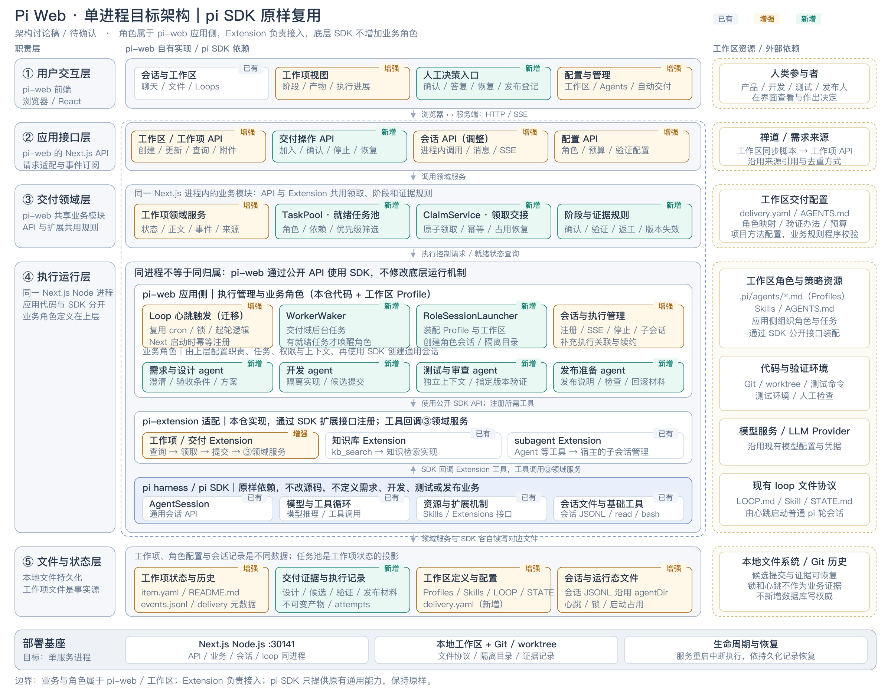

# Pi Web 六层单进程目标架构

日期：2026-10-23

状态：六层架构与中央工作项管理方案 A 已在对话中对齐；尚未修改运行代码。

第一阶段完整设计见 [六层架构收敛与工作项管理](2026-10-23-phase-one-host-and-work-items-design.md)，已获用户批准，实施计划见 plans/ 目录对应两份文件。

明确约束：按用户指定的六层组织；底层 pi SDK 原样复用，不修改 SDK 源码，也不在 SDK 中新增需求、设计、开发、测试或发布角色。交付业务、角色及其编排属于 pi-extension 扩展实现与工作区配置。

范围：在取消独立 daemon 的目标下，对齐整体职责分层、运行位置与实现归属。本文不是 daemon 移除方案或实施计划。

已确认的交付顺序：第一阶段完成架构收敛及工作项管理；多角色自主领取与自动执行放在后续阶段。架构图中展示后续扩展的归属，不表示所有新增能力在第一阶段一起实现。

[可缩放 SVG 原图](assets/work-item-delivery-single-process.svg)

## 1. 目标与当前事实

当前仓库仍使用 Next.js 与 pi-daemon 两个服务端进程，活跃会话由 daemon 持有。
本图讨论的目标是：把会话、子 agent 和 loop 的运行职责收回 Next.js 的常驻 Node.js 宿主，取消独立 daemon、会话 HTTP 代理、sidecar 启动与 daemon 健康探测。
任务唤醒、业务执行和恢复作为扩展内部能力，使用 SDK 原有会话与工具机制；Next.js 接口负责请求适配和宿主装配，文件协议继续复用。

单进程指一个服务端执行宿主，不代表 bash、Git、测试工具不会创建命令子进程。
首版按常驻 Node.js、单实例部署讨论；不把函数即服务、Edge 或多副本部署包含在本次目标中。

## 2. 六个架构层

| 层 | 职责 | 实现与运行位置 |
| --- | --- | --- |
| ① 用户交互层 | 会话、工作区、工作项进展、人工决策与配置 | pi-web 前端 |
| ② 应用接口层 | HTTP 请求适配、认证与输入检查、SSE 事件订阅、扩展/SDK 调用 | pi-web 的 Next.js 接口 |
| ③ pi-extension | 对 pi 的扩展：工作项交付、任务领取、阶段规则、业务角色、loop、subagent、知识库等 | 本仓或工作区提供的扩展代码及其内部服务；通过 SDK 公开扩展接口与宿主入口接入 |
| ④ pi-sdk 层 | AgentSession、模型与工具循环、扩展和资源加载、SessionManager、基础工具 | 原有 pi SDK 依赖，保持源码和通用职责不变 |
| ⑤ 文件与状态层 | 工作项、产物、执行记录、角色/技能/loop 配置、会话 JSONL、临时运行态 | 本地工作区与 agentDir |
| ⑥ 部署基建 | 常驻服务宿主、文件目录、Git/worktree、命令子进程、停止与恢复环境 | 单一 Next.js Node.js 服务端宿主，取消独立 daemon |

这些是职责与能力层，不是六个服务或进程。②③④均在同一个 Next.js Node.js 宿主中执行。
不再单列“交付领域层”“执行运行层”：TaskPool、ClaimService、阶段校验、角色唤醒等是③扩展的内部职责，不成为新的平台分层。
③提供业务语义，④只提供通用运行机制；前端通过②调用③的服务或④的通用接口。

## 3. 扩展层与 SDK 的边界

Next.js Node.js 进程装配扩展和原样 pi SDK。同进程执行不改变二者的代码与职责边界。
扩展不仅是工具函数外壳，可以包含其业务服务、状态协议、执行策略与资源配置；这些通过 SDK 原有工具、命令、事件接口及宿主装配入口接入。
Next.js API 与 SDK 的工具回调复用扩展内部同一份服务实现；HTTP 请求不需要先通过 LLM 才能执行确定性业务操作。

- **工作项/交付扩展**：包含工作项业务、TaskPool、ClaimService、阶段与证据规则，以及角色唤醒、SDK 会话创建与执行跟踪。
- **Loop 触发扩展**：复用现有 cron、到期判断、轮级锁和文件合同，迁移后由常驻 Next.js 宿主幂等装配后台入口。
- **subagent 扩展**：既有 Agent 工具、子会话管理、角色发现与 worktree 能力；底层仍使用原 SDK 会话。
- **知识库及其他扩展**：既有 kb_search 与项目工具，按工作区配置加载。

后台入口在宿主启动时显式装配，不能依赖某个交互会话碰巧启动；不向 SDK 增加全局调度器。
SDK 会话注册、事件转发和生命周期绑定所需的通用宿主胶水留在 Next.js 集成代码中，不包含需求阶段或角色业务规则，也不单独作为架构层。
宿主启动、开发热重载、重复装配、停止与恢复仍需在后续实现中验证。

设计、开发、测试与发布准备 agent 是交付扩展使用的角色策略，由工作区 Profile/Skill 配置职责、任务、权限和上下文。
它们使用原有 AgentSession 接口执行，不属于 SDK 基础层，也不要求拆成四个 Extension。

pi harness / SDK 只提供既有通用能力，不定义工作项、需求阶段或业务角色。
SDK 通过注册工具和事件回调扩展，扩展再操作自己的业务服务与状态；注册扩展不修改 SDK 源码。

## 4. 工作区与外部依赖

角色 Profiles、Skills、AGENTS.md、LOOP.md、STATE.md 与 delivery.yaml 保存在⑤，由扩展和 SDK 按职责加载。
禅道等外部来源仍通过工作区同步脚本调用工作项 API；不因取消 daemon 而重新内置 importer。
用户已确认：同步导入 pi-web 后，以 pi-web 为业务权威。阶段、优先级、需求修订、验收结论及后续交付记录由 pi-web 管理。
导入与同步以外部 source + sourceId 去重，去重范围包含已归档项；重复同步不覆盖本地业务字段，不因来源变化自动恢复、取消或删除工作项。
来源链接、外部编号与初始导入内容用于溯源；首版不做本地状态向禅道的双向同步。来源后续变化的差异提示不列为第一阶段必需能力。
Git 仓库、worktree、测试环境和模型服务仍作为执行依赖。
工作项文件继续作为业务事实源，就绪任务池由其投影得到，不新增数据库写权威。

## 5. 明确的生命周期取舍

浏览器断开不要求结束服务端任务；关闭或重启 Next.js 宿主会中断该宿主持有的执行。
服务恢复后，依据持久化的工作项状态、产物、执行记录与版本进行接续，不承诺恢复内存中的模型调用或命令现场。
接手前仍需确认旧命令进程已停止；服务端退出不自动证明其启动的所有命令子进程均已退出。

迁移后的锁与并发方案应按实际写入者重新设计；不继续仅因为旧双进程布局而把所有调用都视为跨进程。
即使只有一个服务端进程，也仍需要防止并发请求、异步任务与重复触发造成重复领取或过期提交。

## 6. 与旧草案的关系

`2026-10-22-work-item-pull-agents-design.md` 是采用独立 daemon 的早期交付设计草案，保留作讨论记录。
其中的 daemon job 注册、会话代理、sidecar 与写入锁范围等描述不能直接作为本方案的实施依据。
交付业务细节也仍待与本架构整合。本轮只对齐单进程架构图，不将架构讨论视为已批准移除运行中的 daemon。
